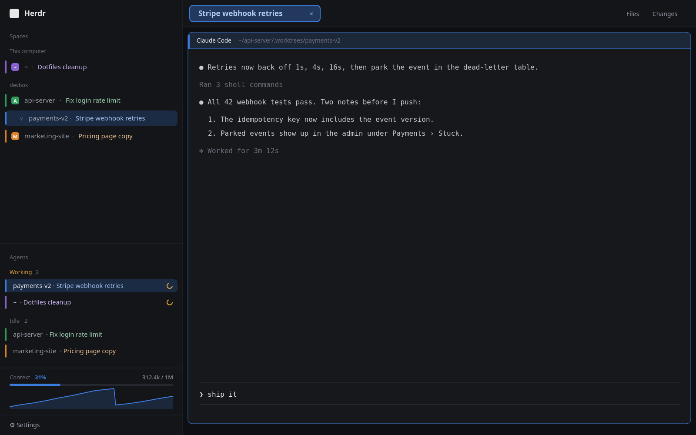

# VM Colors for Herdr

Herdr's main layout, plus one strong color per space, so you always know
which agent you're about to type into. Each space's color shows on its tab
pill, its pane header, its Spaces row and its Agents row. Both lists also
show the agent's session name ("Fix login rate limit") next to the folder,
and a small panel at the bottom of the sidebar shows how much context the
Claude Code agent in view has used.



## Install

```sh
git clone https://github.com/deidyomega/herdr-vm-colors.git
cd herdr-vm-colors
./install.sh
```

The script copies `layouts/vm-colors.*` and `mods/vm-*` into
`~/.config/herdr-app` (or `$HERDR_APP_HOME`), checks each mod and switches
to the layout. It only writes files with those names.

To update: `git pull && ./install.sh`.
To switch back to stock Herdr: `ctrl-shift-l` (cycles layouts).
To remove: delete `layouts/vm-colors.*` and `mods/vm-*` from your Herdr folder.

Or ask your coding agent to add it from this repo; `RECIPE.md` describes
every piece.

## Use

- **Change a space's color:** click the letter square in front of it in
  the Spaces list. The color cycles through 8 and every surface follows.
- **Context panel:** focus a Claude Code agent. It shows `used / 1M` and
  a line of the session so far; drops in the line are compactions.

## Good to know

- **It runs commands.** To read context use, the `vm-context` mod runs
  `hc` and `python3` on the agent's machine and reads Claude Code's own
  files in `~/.claude/` (session list and transcripts). It doesn't send
  anything anywhere. It needs `python3` on each machine that runs agents.
- **It assumes a 1M context window,** which fits current Fable, Opus,
  Sonnet and Haiku 5.5. Change `WINDOW` in `mods/vm-context/main.js` if
  you use something smaller.
- **It's based on Herdr 0.1.16.** The tab bar, sidebar lists and pane
  header are copies of Herdr's own mods from that version, so fixes Herdr
  makes to those later won't show up here until this repo is refreshed.
- **Built for dark themes.**

## License

MIT
