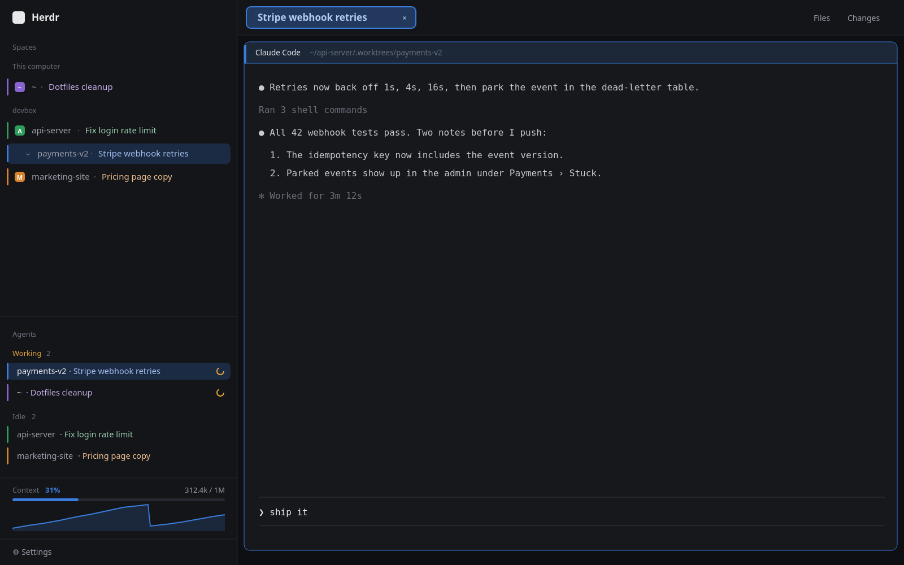

# VM Colors

Herdr's main layout, with one strong color per space, like giving every VM
its own desktop background so you never type into the wrong one. The color
fills the space's tab pill, stripes its pane header, and marks its row in
both the Spaces and Agents lists, which show each agent's session name. A
small panel at the bottom of the sidebar shows how full the context window
is for the Claude Code or Codex agent in view, with a line of how it grew.

## What you see

Left to right: a sidebar, then the work area. Built on Herdr 0.1.16's `main` layout.

- **Sidebar** (`chrome` background, 268 px, resizable 44 to 480):
  - Brand bar, 46 px (shipped `workspace-chrome`).
  - **Spaces**, grouped by machine. Each row is 30 px, rounded 8, with a
    3 px left bar in the space color. Then come an 18 px avatar in that
    color (first letter, white, bold), the folder name (`muted`, at most
    150 px) and ` · `. Last is the agent's session name (its terminal
    title, or the tab's name if someone named it), in the space color
    mixed 45% toward white, medium weight. A space with no agent title
    shows its git tail instead (repo · branch ↑ahead ↓behind, as shipped).
    The active row gets the color at alpha `38` as its background, and a
    hovered row gets alpha `1f`. Every space is its own flat row in the
    order you put them, worktrees too: unlike shipped `spaces`, a worktree
    is never tucked under its main checkout's row.
  - **Agents**, grouped by status (or by space, pinned, as shipped). Each
    row gets a 3 px left bar in its space's color. The session name after
    ` · ` is in the color mixed 45% toward white. The focused agent's row
    has the color at alpha `38`, and a hovered row has alpha `1f`. With
    grouping by space, the group headings are in the space color. In the
    narrow rail, agent numbers are drawn bold in their color.
  - **Context**, 92 px, with a top border. One line reads `Context`
    (`dim`), then the percentage (semibold, in the space color), a spacer,
    and `used / window` (`muted`). Under it is a 4 px bar: `border` track,
    filled to the percentage in the space color. Under that is a 30 px
    line chart of context per reply over the session: a 1.5 px stroke in
    the color over a fill at alpha `26`. Compactions show as cliffs. With
    no Claude Code or Codex agent in view it reads
    `Context · no Claude Code or Codex agent in view`.
  - Footer, 69 px (shipped `workspace-chrome` with `footer: true`).
- **Work area**:
  - **Tab bar**, 48 px (shipped: 42). Pills are 34 px tall, 14 px side
    padding, rounded 8, text 15.5 px semibold, names up to 380 px wide.
    The active pill has a 2 px border in the space color, the color at
    alpha `59` as background, and text mixed 60% toward white. Other
    pills have a 1 px border at alpha `66`, background at alpha `22`, and
    text mixed 30% toward white. Hover shows alpha `44`. Files, Changes and
    the window buttons are as shipped.
  - **Panes**: cards as in `main` (gap 8, radius 10, 1 px `border`,
    `accent` when focused). The 30 px header has the space color at
    alpha `26` behind it, a 4 px left stripe and a bottom divider in the
    color, then program icon, name and folder as shipped.
  - Status bar, 28 px (shipped `workspace-status`).

The eight colors, handed out least-used first: `#2f9e5a` green,
`#3b7ddd` blue, `#d9822b` orange, `#8a63d2` purple, `#d0465a` red,
`#1fa3a3` teal, `#c9a227` yellow, `#c2569b` pink.

## How it behaves

- A new space gets the least-used color. Clicking a space's avatar cycles
  it through the eight, and every surface follows at once.
- Agent status looks as shipped: spinner while `working`, "Needs you"
  (`blocked`), a dot for `done`, nothing for `idle`.
- The Context panel follows the focused Claude Code or Codex agent, on any machine.
  It rereads when that agent's status or turn changes, and every 15 s
  while it works. It updates once per reply, not per streamed token.
- Everything else (drag to reorder spaces, right-click menus, worktrees,
  the side panel, keys) works as in Herdr's `main`.

## Built from

- `layouts/vm-colors.json`: a clone of `main` (`cloned_from` 0.1.16).
  The `spaces`, `agents` and `tabs` blocks and the pane header use the
  clones below. A `context` block (`vm-context`, 92 px) sits between
  `sidebar-lists` and `sidebar-footer`. Root `preview` is
  `layouts/vm-colors.svg`.
- `mods/vm-spaces`, `mods/vm-tabs`, `mods/vm-pane`, `mods/vm-agents`:
  clones of the shipped `spaces`, `tabs`, `pane` and `agents`. Each adds a
  small color helper (space id → hex from shared state, `light(hex, f)`
  mixes toward white) and changes only where rows, pills and the header
  are drawn.
- Shared state `space.colors` maps space id → `#rrggbb`. The shipped
  `spaces` mod writes `ansi*` names into the same key; `vm-spaces` swaps
  those for palette hex on first render, and the other mods read either.
- `mods/vm-context`: a new mod.
  - It reads `agents()` once a second (cheap) to find the focused agent
    with `app` `claude-code` or `codex`.
  - It runs `hc get <address> --json` to get the `claude` process's
    `foreground.pid`.
  - It runs `python3 -c <reader.py> <pid> <app>` with `exec(..., { on: machine })`.
  - `reader.py` reads `~/.claude/sessions/<pid>.json` to get `sessionId`,
    then `~/.claude/projects/*/<sessionId>.jsonl`. It sums `input_tokens +
    cache_creation_input_tokens + cache_read_input_tokens` for each
    main-thread assistant reply, keeps the last entry per `requestId`,
    and returns the latest total plus up to 48 points.
  - For Codex, `reader.py` finds the `~/.codex/sessions/*/*/*/rollout-*.jsonl`
    log that the process (or a child) holds open, through `/proc/<pid>/fd`.
    If none is open, it takes the newest log whose `session_meta.cwd` is the
    process's folder and that was written after the process started. Each
    `token_count` event gives `info.last_token_usage.total_tokens` as a
    point and `info.model_context_window` as the window.
  - Drawing uses `window.paint_path` with `PathBuilder` in percent
    coordinates.
- Shipped pieces it relies on: `workspace-chrome`, `workspace-status`,
  `files`, `changes`, `menu`, `new-menu`, `machine-add`, and icons
  in `mods/workspace-chrome/` and `mods/pane/`.

## Watch out

- These are copies of Herdr 0.1.16's mods. Herdr's updates to its own
  `main`, `spaces`, `tabs`, `pane` and `agents` won't reach them. To pick
  those up, re-clone and re-apply the color changes (each is small and
  commented).
- `vm-context` runs programs (`hc`, `python3`) and reads files outside its
  folder (`~/.claude/sessions`, `~/.claude/projects`) on the agent's
  machine. It needs `python3` there. It sends nothing over the network.
- For Claude Code the context window is assumed to be 1M (`WINDOW` in
  `mods/vm-context/main.js`). That's right for current Fable, Opus,
  Sonnet and Haiku 5.5; Haiku 4.5 is 200K. Codex logs its own window.
- It depends on Claude Code's and Codex's own session files, which aren't
  public formats and could change. Finding a Codex log through `/proc`
  works on Linux only; elsewhere it falls back to the folder match.
- `PathBuilder` may return a new builder per call: chain the calls
  (`reduce`), don't mutate.
- Colors are strong on purpose. On a light theme the tinted text (mixed
  toward white) is too pale; this is built for dark themes.

## Done when

- `herdr-app check` passes for each of the five mods, and
  `herdr-app status` shows no errors after `layout.switch {name: "vm-colors"}`.
- Two spaces get different colors. The active one's tab pill, pane header
  stripe, Spaces row and Agents row all show the same color.
- A Spaces row reads `folder · session name` for a space with an agent.
- Clicking a space's avatar changes its color everywhere.
- With a Claude Code or Codex agent focused, Context shows a percentage and
  `N.Nk / 1M` that match the session's last reply, on this machine and on
  a remote one.
